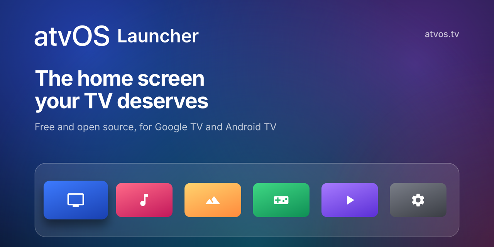

# atvOS Launcher

[](https://atvos.tv)

[Website](https://atvos.tv) · [Google Play](https://play.google.com/store/apps/details?id=app.atvos.launcher) ·
[Privacy policy](https://atvos.tv/privacy) · [Report a problem](https://github.com/shivangswain/atvos-launcher/issues)

atvOS Launcher is a home screen for Google TV and Android TV, inspired by the tvOS Home Screen. It
puts your favourite apps in a glass dock, shows each app's top shelf behind it, and keeps the rest
of your apps in a grid below. A clock in the corner opens a Control Center.

atvOS Launcher is an independent project. It is not affiliated with or endorsed by Apple. Apple TV
and tvOS are trademarks of Apple Inc.

## Features

- **Top shelf.** The focused app in the dock fills the screen with what it recommends: a full-screen
  picture with a **Play** button, or a row of **Continue Watching** and **Recommended** cards.
- **Your layout.** Reorder apps, make folders and hide the apps you don't use.
- **Control Center.** Power, network, Do Not Disturb, Bluetooth, a sleep timer and shortcuts to
  inputs, accessibility, system settings and search.
- **Settings.** Light or dark appearance, 12- or 24-hour clock, and a profile picture from your
  Google account.
- **TalkBack.** Every tile, button and menu option is read aloud as you reach it.
- **Private.** atvOS Launcher collects nothing. It uses the network only for artwork and your
  profile photo, over HTTPS.

## Requirements

- A Google TV or Android TV device with Android 12 or later.
- On most Google TV and Android TV devices, **Developer options** and **USB debugging**, so that the
  Home button can open atvOS Launcher (see [Set up](#set-up)).

## Install

Install atvOS Launcher from
[Google Play](https://play.google.com/store/apps/details?id=app.atvos.launcher).

## Set up

On first launch, a card on the TV walks you through the steps that are left. It skips the steps
that are already done, shows a picture of each TV Settings screen, and opens that screen for you.
Select **Not Now** to skip setup. To run it later, open atvOS Settings > **Home Screen**.

1. **Turn On Developer Options.** Opens the TV's About screen. Select the build row seven times.
2. **Turn On USB Debugging.** Opens Developer options.
3. **Allow USB Debugging.** Select **Set Up**, then **Allow** on the TV's prompt. atvOS Launcher
   becomes the home app and turns off the TV's built-in home screen.
4. **Make It Your Home Screen.** On a TV whose home app is not locked, Android's home app dialog
   opens instead of steps 1 to 3.
5. **Add Your Profile Picture** (optional). Choose your Google account.

**Why steps 1 to 3:** the built-in home screens of Google TV and Android TV keep the Home button even
after you choose a different home app. atvOS Launcher turns them off through the TV's own debugging
connection (127.0.0.1:5555). It sends only two fixed commands: one that turns off the built-in home
screen and one that turns it back on. It uses the debugging connection for nothing else.

When setup ends the first time, the TV asks you to allow access to app recommendations.

**Settings and Guide buttons:** on Google TV, these remote buttons open panels that belong to the
built-in home screen. While atvOS Launcher replaces it, they do nothing. To open the TV's settings,
select the clock, then the settings button in the Control Center. **Restore Default Launcher**
brings the buttons back.

## Privacy and permissions

atvOS Launcher collects and shares nothing. Your Google account address and profile photo stay on
the TV. The access token for the photo is not stored. Donations go through Google Play.

| Permission | Use | How you allow it |
| --- | --- | --- |
| Access to TV listings (`READ_TV_LISTINGS`) | Reads the Watch Next and preview programs of your apps for the top shelf. | A prompt after the first setup. |
| Internet (`INTERNET`) | Downloads top shelf artwork and your profile photo, over HTTPS only. | At install. |
| Network state (`ACCESS_NETWORK_STATE`) | Shows the connection in the Control Center. | At install. |
| Do Not Disturb access (`ACCESS_NOTIFICATION_POLICY`) | The Do Not Disturb tile. | Android's Do Not Disturb access screen, if the TV has one. |
| Delete apps (`REQUEST_DELETE_PACKAGES`) | Opens Android's uninstall screen for **Delete App**. | At install. |
| Google Play billing (`com.android.vending.BILLING`) | **Donate**. | At install. |
| Alarms & reminders (`SCHEDULE_EXACT_ALARM`) | Puts the TV to sleep at the exact time of the sleep timer. | At install up to Android 13. From Android 14, the first sleep timer press opens **Alarms & reminders**. |
| Device admin, lock screen only | Power Off and the sleep timer. It cannot erase, reset or read anything. | A prompt the first time that you use Power Off or the sleep timer. |

## Uninstall

1. Open atvOS Settings > **Uninstall** and select **Restore Default Launcher**. The TV's built-in
   home screen comes back.
2. Select **Remove Power Control**. Android cannot uninstall an app that has device admin access.
3. Open Settings > **Support** > **App Info** and select **Uninstall**.

## Build from source

You need JDK 21 or later and the Android SDK. Android Studio writes the SDK location to
`local.properties`.

```bash
./gradlew assembleDebug
```

The only dependency is Google Play Billing, without its transitive libraries. The app has no
AndroidX, Google Play services or Kotlin.

To build a signed bundle for Google Play, add a `keystore.properties` file with your upload key.
Without it, release builds use the debug key.

```properties
storeFile=release.jks
storePassword=…
keyAlias=…
keyPassword=…
```

```bash
./gradlew bundleRelease
```

### Continuous integration

- **GitHub Actions** and **GitLab CI** run the same build: `./gradlew build bundleRelease`. It lints the app and makes the debug APK, the release APK and the app bundle. Both run it for each push to `main` and each version tag. GitHub Actions also runs it for each pull request.
- **Version tags** (`v1.0`, or `v1.0-pre.3` for a pre-release) also make a release with the APKs, the app bundle and `SHA256SUMS`, the SHA-256 digest of each file:
  - **GitHub:** a draft release, and a signed build provenance attestation for each file. Check a file with `gh attestation verify FILE --repo shivangswain/atvos-launcher`.
  - **GitLab:** the files in the package registry (package `atvos-launcher`, version = the tag), a release that links to them, and the runner's provenance statement in the job artifacts.
- **Release signing:** to sign the builds with your upload key, add `ANDROID_KEYSTORE_BASE64` (the keystore file in Base64), `ANDROID_KEYSTORE_PASSWORD`, `ANDROID_KEY_ALIAS` and `ANDROID_KEY_PASSWORD`. On GitHub, add them as repository secrets. On GitLab, add them as masked and protected CI/CD variables, and protect the `v*` tags.

### Google profile photo

The profile photo uses Google's basic profile scope (`userinfo.profile`) through the Google account on
the TV. Google gives the photo only to an app with an OAuth client that matches its package name and
signing key. To make the photo work for every user:

1. In [Google Search Console](https://search.google.com/search-console), verify that you own the
   domain of the home page (`atvos.tv`), with a DNS TXT record.
2. In the [Google Cloud console](https://console.cloud.google.com/), open the project and go to
   **Google Auth Platform**:
   - **Branding:** the app name, a support email, the home page `https://atvos.tv`, the privacy
     policy `https://atvos.tv/privacy`, and `atvos.tv` as an authorized domain.
   - **Data access:** only the `.../auth/userinfo.profile` scope. It is a non-sensitive scope, so it
     does not need Google's app verification.
   - **Clients:** an **Android** client for `app.atvos.launcher` for each signing key: the app signing
     key from Play Console > **Test and release** > **App integrity** (copies from Google Play), and
     the upload or debug key of the builds that you install yourself.
   - **Audience:** **Publish app**, to move it from **Testing** to **In production**. In Testing,
     only the listed test users get a photo.

Without a matching client, the profile picture shows the first letter of the account.

### Donations

Donations need a consumable in-app product with the id `donation` in Play Console. Donations work
only in a copy installed from Google Play.

### Website

The website, [atvos.tv](https://atvos.tv), is in `website/`. It is a static [Astro](https://astro.build)
site with no client JavaScript, hosted on Cloudflare Pages. It has the privacy policy that the app
and Play Console link to. You need Node.js 22.12 or later.

```bash
cd website
npm ci
npm run dev      # a local copy at http://localhost:4321
npm run build    # the finished site, in website/dist
```

Cloudflare Pages builds and publishes the site from GitHub when a push to `main` changes
`website/`. The link preview image, the logo and the README banner come from `website/social/`
(`card.html` and `logo.svg`). On a Mac, `render.swift` draws them again: see the comment at its top. When atvOS Launcher is on Google Play, set `onPlay` to `true` in
`website/src/site.ts`.

## License

atvOS Launcher is free software, licensed under the GNU General Public License v3.0. See
[LICENSE.md](LICENSE.md).
